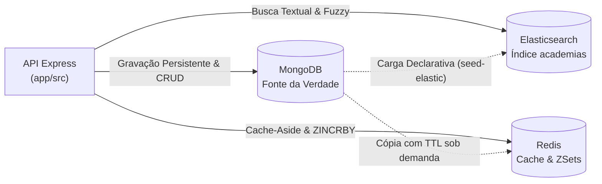

# Checkpoint 2 — Treinna (App de Check-in em Academias)
**Disciplina:** Banco de Dados NoSQL (TSI34E-TSI4) — UTFPR Câmpus Guarapuava  
**Professor:** Prof. Marcelo Marcos Vichar Junior  
**Alunos:** Ana Clara Novak, Eduardo de Almeida Fernandes, Matheus Lorenzo Siqueira  
**Data:** 27/10/2026  

---

## 1. Arquitetura e Fonte da Verdade

O **Treinna** adota uma arquitetura híbrida orientada a múltiplos paradigmas NoSQL para atender aos requisitos de alta vazão, baixa latência e buscas por relevância tolerantes a falhas:
* **MongoDB (Document-Store):** Atua como a **Fonte da Verdade** corporativa e persistente.
* **Redis (In-Memory Key-Value & Data Structures):** Camada de aceleração de leitura com *Cache-Aside* e gerenciamento de estados dinâmicos (Rankings em tempo real).
* **Elasticsearch (Search Engine / Inverted Index):** Motor dedicado à busca textual distribuída e consultas por similaridade.



### Tabela de Fontes da Verdade e Cópias Derivadas

| Entidade / Dado | Fonte da Verdade | Cópias Derivadas | Justificativa Arquitetural da Cópia |
| :--- | :--- | :--- | :--- |
| **Planos de Assinatura** | MongoDB (`plans`) | Redis (`treinna:plans:todos`) | Vitrine pública lida milhares de vezes ao dia; preços mudam raramente. O cache elimina I/O em disco. |
| **Academias Parceiras** | MongoDB (`gyms`) | Elasticsearch (`academias`) e Redis (`treinna:gym:<id>`, TTL 300 s, via `GET /api/gyms/:id`) | O índice permite busca com tolerância a erros de digitação (`fuzziness`) e relevância ponderada; o cache acelera a tela de detalhe. |
| **Check-ins e Validações** | MongoDB (`checkins`) | Nenhuma cópia permanente | Transação crítica de acesso e faturamento de repasse; exige consistência estrita imediata. |
| **Ranking de Frequência** | MongoDB (`checkins`) | Redis Sorted Set (`treinna:ranking:gyms`) | Evita agregações pesadas (`$group` + `$sort`) a cada abertura da home. O ZSet é incrementado a cada check-in validado e mantém a ordenação em RAM. Como é derivado, pode ser reconstruído a partir dos check-ins validados. |
| **Histórico e Alunos** | MongoDB (`users`) | Nenhuma cópia permanente | Perfil e credenciais com ciclo de vida estritamente acoplado ao banco principal. |
| **Avaliações das Academias** | MongoDB (`reviews`) | MongoDB (`gyms.ultimas_avaliacoes`, subconjunto embutido) e, por consequência, Redis (`treinna:gym:<id>`) | As avaliações completas ficam em `reviews`; as mais recentes são embutidas na academia (padrão *Subset* do Checkpoint 1) para a tela de detalhe não precisar de `$lookup`. Como o cache da academia guarda o documento inteiro, elas também entram nessa cópia com TTL. Não vão para o Elasticsearch porque a busca não usa o texto das avaliações. |
| **Fila de Sincronização Pendente** | Redis List (`treinna:sync:pendentes`) | Nenhuma cópia | Dado operacional que só existe no Redis: guarda os `_id` de academias cuja atualização no Elasticsearch falhou. Não é cópia de nada; o conteúdo reindexado é sempre lido do MongoDB no reprocessamento. |
| **Configuração da Aplicação** | Redis Hash (`treinna:config:app`) | Nenhuma cópia | Metadados não críticos (versão, ambiente, cidade padrão) carregados por `init/redis-init.commands` no `./iniciar.sh`; podem ser recriados a qualquer momento a partir desse arquivo. |

---

## 2. Redis como Cache

**Rota Implementada:** `GET /api/plans`  
**Padrão:** *Cache-Aside* (Lazy Loading)  
**Chave:** `treinna:plans:todos`  
**TTL:** `300 segundos` (5 minutos)

### Fluxo de Execução:
1. A API recebe a requisição e verifica a presença da chave `treinna:plans:todos` no Redis (`cacheGet`).
2. **Cache Hit:** Caso exista, entrega os dados em tempo sub-milissegundo (< 1ms) sem consultar o banco em disco.
3. **Cache Miss:** Caso não exista, executa `db.plans.find().toArray()` no MongoDB, salva o payload no Redis com TTL de 300s (`cacheSet`) e responde a requisição.

**Justificativa do TTL:** Planos de academia (Basic, Silver, Gold) são alterados esporadicamente pelo departamento comercial. Cinco minutos evitam sobrecarga de leitura e servem de salvaguarda caso ocorram alterações externas fora do ciclo da aplicação.

**Invalidação Ativa:** Quando o preço de um plano é alterado (`PATCH /api/plans/:id/preco`), o backend executa imediatamente `await cacheDel("treinna:plans:todos")`, forçando a leitura seguinte a buscar os dados atualizados no MongoDB.

---

## 3. Redis como Estrutura de Dados Avançada

**Caso de Uso:** Leaderboard da Home — Academias mais frequentadas no app.  
**Estrutura Escolhida:** **Sorted Set (ZSet)**  
**Padrão de Nomenclatura:** `treinna:ranking:gyms`  

### Comandos Utilizados:
* `ZINCRBY treinna:ranking:gyms 1 "<Nome da Academia>"`: Disparado na validação de entrada na catraca (`PATCH /api/checkins/:id/validar`), somente na transição para `validado` (validar de novo não duplica a contagem). Se o Redis falhar, a validação no MongoDB é mantida. O endpoint `POST /api/gyms/ranking/checkin` permite simular acessos em massa na demonstração.
* `ZREVRANGE treinna:ranking:gyms 0 4 WITHSCORES`: Consumido pelo endpoint `GET /api/gyms/ranking/top?limite=5`, recuperando o Top 5 instantaneamente em complexidade $O(\log N)$.

**Justificativa:** O cálculo de ranking a partir de milhões de documentos históricos no MongoDB exigiria agregação analítica contínua e pesada. O Sorted Set armazena e reordena os dados de maneira incremental diretamente na memória RAM.

---

## 4. Elasticsearch: Mapping e Indexação

**Arquivo Declarativo:** `init/elastic-init.json`  
**Índice:** `academias`  
**Analisador Customizado:** `texto_ptbr` (Standard Tokenizer, Lowercase, Stop Words em português, Stemmer minimal para plurais e Asciifolding para remoção de acentos).

### Mapping de Campos e Justificativa de Tipos:

| Campo | Tipo no Mapping | Justificativa Técnica |
| :--- | :---: | :--- |
| `nome` | `text` | Analisado por termos para buscas parciais e relevância com peso aumentado. |
| `modalidades` | `text` | Texto analisado permitindo correspondência flexível (ex: "Crossfit", "Musculação"). |
| `cidade` | `keyword` | Valor exato; utilizado para agrupamento territorial e filtros sem tokenização. |
| `ativo` | `boolean` | Filtro booleano binário em queries de exclusão sumária. |
| `mensalidade_base` | `float` | Campo numérico para aplicação de ranges de preço (`lte`, `gte`). |
| `gym_id` | `keyword` | Identificador único de amarração referencial com o MongoDB (`_id`). |

*Nota de Conformidade:* O parâmetro obsoleto `boost` não é utilizado no mapping estrutural (incompatível com o Elasticsearch 8.x); os pesos são atribuídos em tempo de consulta.

**Sincronização Inicial:** O script `app/src/scripts/seed-elastic.ts` lê a coleção `gyms` do MongoDB no startup e popula o índice `academias` (`nome`, `modalidades`, `cidade`, `ativo`, `mensalidade_base`), sendo invocado automaticamente pelo `./iniciar.sh`. O campo `cidade` vem do documento da academia no MongoDB.

---

## 5. Elasticsearch: Busca Complexa

**Rota Implementada:** `GET /api/gyms/search?q=<texto>&cidade=<cidade>&preco_max=<valor>`  
**Arquivo:** `app/src/controllers/gyms.controller.ts`

### Estrutura da Consulta (`bool` com `must` e `filter`):
* **Ponderação de Relevância (`multi_match`):** Aplicação de pesos específicos nos campos textuais:
  * `nome^3`: O nome da academia possui peso preponderante na intenção de busca.
  * `modalidades^1`: Modalidades têm peso padrão de desempate.
* **Tolerância a Erro (`fuzziness: "AUTO"`):** Aceita variações tipográficas do usuário (ex: digitar *"crozfit"* encontra *"Crossfit"*, digitar *"uplayy"* encontra *"Uplay"*).
* **Filtros Exatos (`filter`):**
  * `term: { ativo: true }`: Exclusão obrigatória de academias inativas/em reforma sem penalizar o `_score`.
  * `term: { cidade: "Guarapuava" }` (opcional): Filtro exato por localidade.
  * `range: { mensalidade_base: { lte: precoMax } }` (opcional): Filtro econômico.

---

## 6. Integração e Sincronização entre Bancos

**Rota de Escrita Sincronizada:** `PATCH /api/gyms/:id` (Atualização de dados da academia).

### Ordem Estrita das Operações:
1. **Passo 1 (MongoDB):** Atualiza os dados via `findOneAndUpdate` e recupera o documento modificado. Se a gravação falhar, o processo aborta sem alterar os demais bancos.
2. **Passo 2 (Redis):** Invalida o cache individual da academia, `treinna:gym:<id>` (`cacheDel`).
3. **Passo 3 (Elasticsearch):** Executa `elastic.index()` com o ID da academia e a flag `refresh: "wait_for"`, garantindo visibilidade imediata no motor de busca.

### Respostas aos Critérios de Sincronização:

**1. Depois de uma alteração, em quanto tempo a busca e o cache passam a mostrar o dado novo?**  
* **No Cache (Redis):** Na requisição subsequente à mutação. Como a chave foi removida ativamente no Passo 2, a leitura seguinte resulta em um `CACHE MISS` limpo, lendo o dado atualizado do MongoDB e repovoando a memória RAM.
* **Na Busca (Elasticsearch):** Imediatamente ao término da requisição HTTP, graças ao uso de `refresh: "wait_for"`. Sem essa flag, o dado apareceria no ciclo de refresh automático do cluster (em até 1 segundo).

**2. O que acontece se a gravação no MongoDB der certo e a atualização do Elasticsearch falhar?**  
A alteração **não é desfeita no MongoDB**, pois ele é a Fonte da Verdade. A API captura a falha em bloco `try/catch`, registra o `_id` da academia no final de uma List no Redis (`treinna:sync:pendentes`) e devolve o status `HTTP 202 Accepted` avisando que a sincronização foi agendada. Um endpoint de reprocessamento (`POST /api/gyms/sincronizacao/reprocessar`; a fila pode ser consultada em `GET /api/gyms/sincronizacao/pendentes`) desempilha os IDs da fila e reindexa os documentos lendo o estado atual do MongoDB.

---

## 7. Roteiro de Demonstração Prática

Comandos para comprovação sequencial via terminal (ambiente executado via `./iniciar.sh`):

### 7.1. Cache-Aside no Redis (Miss vs Hit)
```bash
# 1ª Requisição (Cache Miss - lê do MongoDB e salva no Redis)
curl -s http://localhost:3400/api/plans | jq '{origem, tempo_resposta, total}'

# 2ª Requisição imediata (Cache Hit - responde da RAM)
curl -s http://localhost:3400/api/plans | jq '{origem, tempo_resposta, total}'
```
*Saída Esperada:* Origem `MONGODB (CACHE MISS)` na primeira chamada (alguns ms) e `REDIS (CACHE HIT)` na segunda, com tempo bem menor (em torno de 1 ms ou menos; o valor exato varia por máquina).

### 7.2. Estrutura Avançada do Redis (Sorted Set)
```bash
# Simular validações na catraca acumulando check-ins
curl -s -X POST http://localhost:3400/api/gyms/ranking/checkin -H "Content-Type: application/json" -d '{"gym": "Uplay Guarapuava", "quantidade": 3}' | jq .
curl -s -X POST http://localhost:3400/api/gyms/ranking/checkin -H "Content-Type: application/json" -d '{"gym": "Ironberg Guarapuava", "quantidade": 5}' | jq .

# Consultar o Top 2 Academias mais frequentadas
curl -s "http://localhost:3400/api/gyms/ranking/top?limite=2" | jq .
```
*Saída Esperada:* Ironberg em 1º lugar (score 5) e Uplay em 2º lugar (score 3) ordenados em tempo real pelo Redis.

```bash
# Validar um check-in real na catraca (o check-in pendente do seed é na Academia Flex)
CHECKIN_ID=$(docker exec nosql_mongo mongosh -u root -p root --quiet --eval 'db.getSiblingDB("treinna").checkins.findOne({status:"pendente"})._id.toString()')
curl -s -X PATCH "http://localhost:3400/api/checkins/$CHECKIN_ID/validar" | jq -c .
curl -s "http://localhost:3400/api/gyms/ranking/top" | jq -c .ranking
```
*Saída Esperada:* A validação retorna `{"mensagem":"Acesso validado com sucesso!","mongodb":"gravado","ranking":"incrementado (+1)"}` e o ranking passa a ter a "Academia Flex" em 3º lugar com `checkins: 1`. Repetir a validação retorna `"Check-in já estava validado."` e o score não muda.

### 7.3. Busca com Erro de Digitação (Fuzzy Match)
```bash
# Busca com digitação incorreta
curl -s "http://localhost:3400/api/gyms/search?q=crosfit" | jq '[.resultados[] | {nome, relevancia}]'
```
*Saída Esperada:* Retorna "Crossfit Guarapuava" e "Uplay Guarapuava" com score de similaridade calculado pelo Elasticsearch.

### 7.4. Busca com Filtro Exato
```bash
# Busca textual com filtro de preço máximo
curl -s "http://localhost:3400/api/gyms/search?q=musculacao&preco_max=100&cidade=Guarapuava" | jq '{total, academias: [.resultados[].nome]}'
```
*Saída Esperada:* Retorna apenas "Academia Flex" (R$ 70,00), eliminando academias que ultrapassam o teto estipulado.

### 7.5. Escrita Sincronizada e Invalidação
```bash
# Guardar o ID da Uplay Guarapuava (a academia exatamente nas coordenadas abaixo)
ID=$(curl -s "http://localhost:3400/api/gyms/near?lng=-51.4628&lat=-25.3953" | jq -r '.[0]._id')

# Ler a academia (miss, depois hit) para popular o cache
curl -s "http://localhost:3400/api/gyms/$ID" | jq -c '{origem}'
curl -s "http://localhost:3400/api/gyms/$ID" | jq -c '{origem}'

# Atualizar nome da academia com sincronização tripla
curl -s -X PATCH "http://localhost:3400/api/gyms/$ID" \
  -H "Content-Type: application/json" \
  -d '{"nome": "Uplay Prime Guarapuava"}' | jq -c .

# Conferir na busca textual e na leitura (cache invalidado => novo MISS com o nome novo)
curl -s "http://localhost:3400/api/gyms/search?q=prime" | jq '.resultados[0].nome'
curl -s "http://localhost:3400/api/gyms/$ID" | jq -c '{origem, nome: .academia.nome}'
```
*Saída Esperada:*
```
{"origem":"MONGODB (CACHE MISS)"}
{"origem":"REDIS (CACHE HIT)"}
{"mongodb":"gravado","redis":"invalidado","elasticsearch":"atualizado (1 documento)"}
"Uplay Prime Guarapuava"
{"origem":"MONGODB (CACHE MISS)","nome":"Uplay Prime Guarapuava"}
```

### 7.6. Falha do Elasticsearch e Reprocessamento
```bash
# Usa o mesmo $ID do passo 7.5
curl -s -X PATCH "http://localhost:3400/api/gyms/$ID?simular_falha=elastic" -H "Content-Type: application/json" -d '{"mensalidade_base": 99}' -w ' [%{http_code}]\n'
curl -s http://localhost:3400/api/gyms/sincronizacao/pendentes | jq -c .
curl -s -X POST http://localhost:3400/api/gyms/sincronizacao/reprocessar | jq -c .
curl -s http://localhost:3400/api/gyms/sincronizacao/pendentes | jq -c '{total}'
```
*Saída Esperada:* HTTP 202 com `elasticsearch: falhou (ElasticSearch fora do ar); pendência registrada`; a fila `treinna:sync:pendentes` lista 1 ID (o `$ID`); o reprocessamento retorna `{"reprocessadas_total":1,"academias_recuperadas":["Uplay Prime Guarapuava"]}` e a fila fica com `{"total":0}`.